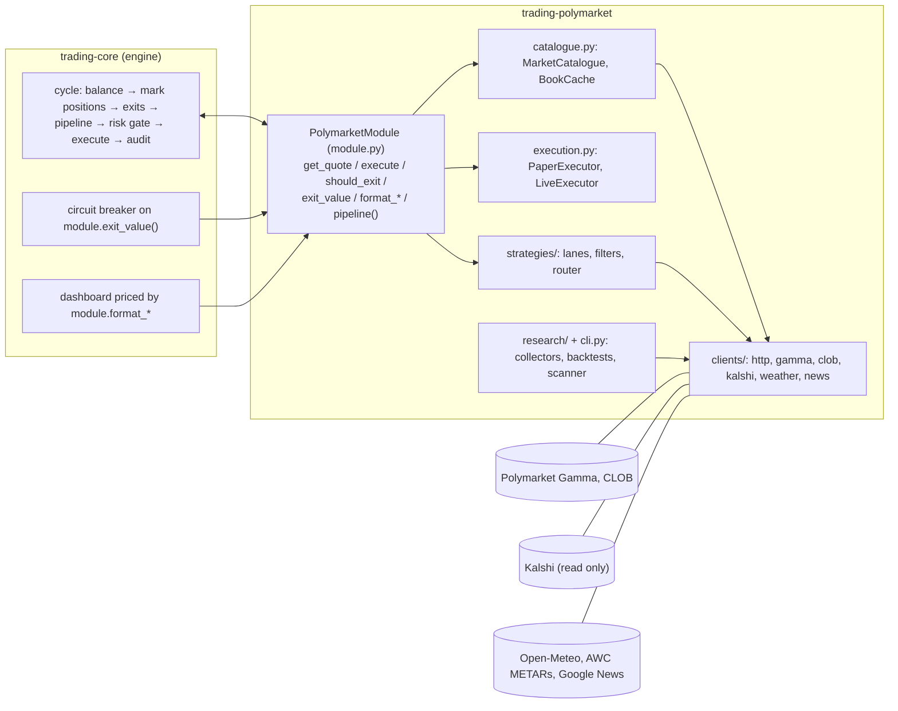

# Architecture

trading-polymarket is a **trading module** for trading-core. trading-core owns
the engine loop, risk gate, circuit breaker, positions, net-PnL accounting,
audit trail, alerts, dashboard and audit tools; this package owns everything
that is Polymarket: market data, fees, paper fills, settlement, the lanes and
the research tools. The only door between them is trading-core's
`TradingModule` contract.

## 1. How the pieces fit



## 2. Package map

```text
trading_polymarket/
├── module.py        # PolymarketModule: the TradingModule implementation (entry point "polymarket")
├── config.py        # PolymarketSettings and the lane settings (module_settings)
├── markets.py       # Market parsed from Gamma; tokens, resolution, payout
├── book.py          # OrderBook from the CLOB; depth, imbalance, walk_buy / walk_sell
├── fees.py          # FeeSchedule: shares × rate × (p(1-p))^exponent, rounded to 5 dp
├── catalogue.py     # MarketCatalogue (by token, TTL) and BookCache (TTL)
├── execution.py     # PaperExecutor (book-walking fills, fees, redemption); LiveExecutor (refuses)
├── calibration.py   # CalibrationTable: price × hours bins, shrunk win rates
├── pairs.py         # VenuePair, Reference, the Fed bucket matcher (match_fed), the reviewed pairs file
├── clients/         # http (paced, retrying, injectable transport), gamma, clob, kalshi, weather, news
├── strategies/      # common pricing, filters, router; lanes: weather, favourite, momentum,
│                    #   crossvenue (the fed and crossvenue lanes: ReferenceScout / ReferenceAnalyst)
├── research/        # records (audit format), history, backtest, weather_backtest, metar_archive,
│                    #   fed, pairs_suggest, bias, arb, recorder
├── data/            # stations.json (ICAO → coordinates), shipped with the package
├── cli.py           # trading-polymarket
└── tests/           # mirrored unit tests, integration, property; 100% coverage
```

## 3. The module contract, method by method

| Method | Implementation |
|---|---|
| `quote` | `QuoteAsset("USDC", decimals=2, atomic_decimals=6, prefix="$", grouping=True)` |
| `start` / `stop` | Start / cancel the heartbeat: every `heartbeat_seconds` read the most traded open market and its book, notify the host on success, report `polymarket data` degraded after 3 failures in a row (TP-10). Health so tracks the venue whether a position is held or not |
| `get_quote(token)` | Resolved market (cached): bid = ask = last = payout. Otherwise the CLOB book (`BookCache`, `quote_ttl_seconds`); first quote of a token also caches its market. Book gone (404): re-read the market (asking Gamma for closed markets too, TP-9); resolved → payout quote, otherwise a **stale** quote (the engine holds and fires no price exit). Notifies the host on every fresh book |
| `get_balance()` | Refuses (the paper balance is the engine's; live execution is not built) |
| `execute(order, paper)` | Paper → `PaperExecutor`; live → `LiveExecutor` (refuses) |
| `pipeline()` | Built once: one scout + analyst per enabled lane, `MarketStateFilter` → `BookFilter` → `LaneRouter` |
| `should_exit` | Market resolved → `ExitDecision("resolved")`; a `fed` or `crossvenue` position whose bid reached the fresh Kalshi mid (− `convergence_margin`) → `"converged"`; optional `exit_at_bid` target |
| `exit_value` | Resolved → size × payout; closed and awaiting resolution → size × the token's final Gamma price; else walk the cached bids for the whole size, minus the taker fee (0 with no bids, TP-5); no cached book → trading-core's default |
| `format_price` / `format_size` | Cents (`61.5¢`); shares with 2 decimals |
| `instrument_label` | The bucket/market name when known, else `111111…1111` |
| `status_rows` | `api requests` (with retries), `api failures`, `markets cached`, `last api error` |
| `strategy_rows` | Enabled lanes and their key thresholds; flags a missing calibration |
| `files` | Not overridden: the module writes no file during a run, so the Engine panel lists only the engine's files (research commands write under `data/`, outside runs) |
| `is_public_identifier` | Token ids (≥ 20 digits) and condition ids (`0x` + 64 hex) are not masked as secrets |
| `provenance` | Module version, all settings, fee model, calibration sha256 and whether it is the identity table (recorded in every run's `run_started`) |

## 4. One cycle, from the module's side

1. **Mark**: `get_quote` for every open token (cached books, ≤ `quote_ttl_seconds` old).
2. **Exits**: `should_exit` — a market that resolved since the last cycle is
   sold; `PaperExecutor.sell` re-reads the market (`max_age=0`, TP-3) and
   redeems at the payout with no fee.
3. **Entries**: `pipeline().run(exclude=held tokens)` (`LanePipeline`: the
   complements of held tokens are excluded too, TP-8):
   - scouts list candidates (weather events priced by the model; closing
     favourites; sharp moves; Polymarket tokens paired with a Kalshi
     reference) and put their markets in the catalogue;
   - `MarketStateFilter` (open, volume, liquidity — lane thresholds) and
     `BookFilter` (live book: spread, depth near the ask) screen them and
     record metrics;
   - `LaneRouter` sends each survivor to its lane's analyst, which re-prices
     on the live book and returns a `Signal` with notional, limit price, edge,
     `strategy=<lane>` and metrics;
   - `LanePipeline` drops signals that would take a lane past its
     `max_positions_per_day` in markets closing on one UTC date, counting
     what it already holds there (TP-12).
4. **Risk + execution**: trading-core checks each signal against its risk
   limits, then calls `execute`; `PaperExecutor.buy` reads a **fresh** book
   and walks it within the limit.
5. **Audit**: trading-core writes the trade with the fill's fee as the `fee`
   cost component and the signal's metrics as `entry_metrics`.

## 5. Fill model (paper)

- No fill without a fresh book (`max_age=0`); closed, paused or unknown markets refuse.
- Buy: spend at most the notional on asks ≤ limit (signal limit, else best
  ask + `max_slippage`, never above `price_cap`); shares rounded down to 0.01;
  refuse below the market's `orderMinSize` or `paper.min_notional`.
- Sell: sell at most the size into bids ≥ limit (signal limit, else best bid −
  `max_slippage`); partial fills are reported (`partial: true`).
- Fee per level: `taker_fee(shares, price)`, summed, recorded as `costs.fee`.
- Resolution: redeem at 1 or 0, fee 0, `reference: paper-redeem-…`.

What paper cannot model: queue position behind resting orders at the same
price, latency between the read and the fill, and the book's reaction to our
own order. The live canary measures those.

## 6. Design rules

- **Fail closed**: a missing book is a stale quote; a filter that errors
  rejects; an unknown fee schedule is priced at the highest rate; an analyst
  with no edge returns no signal.
- **One HTTP client** for everything (pacing, retries, counters); the
  transport is injectable, so tests never touch the network.
- **Lanes are independent**: own thresholds, own `strategy` tag, own verdict.
- **Research writes trading-core audit records**, so the same audit tools and
  the same pre-registered rules judge backtests, paper runs and live runs.
