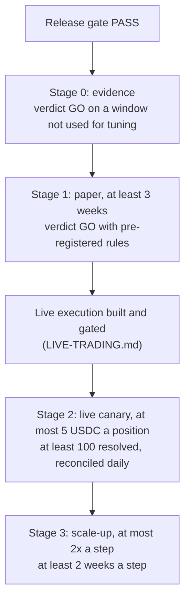

# Release gate

This page decides **when trading-polymarket may ship a release** and **when it
may put more money behind a lane**. It is a reusable checklist, not a log: run
it for every release and every capital stage, then write the outcome into a
release record ([§5](#5-release-record)) and `CHANGELOG.md`. Its §1 is the
only place the current status of releases, lanes and runs is written.

- How to operate a run day to day: [`RUNBOOK.md`](RUNBOOK.md).
- How the evidence is produced: [`../RESEARCH.md`](../RESEARCH.md); every
  result so far: [`RESULTS.md`](RESULTS.md).
- What each lane does and why it might make money: [`../STRATEGY.md`](../STRATEGY.md).
- Known defects: [`BUGS.md`](BUGS.md).

There are two independent gates:

| Gate | When it runs | Question it answers |
|---|---|---|
| **Release gate** ([§2](#2-release-gate-every-release)) | Every tagged release, before it runs anywhere that matters | Is this build correct, safe and recoverable? |
| **Capital gate** ([§3](#3-capital-gate)) | Before each stage (evidence → paper → live canary → scale-up), per lane | Does this lane make money after fees, and do the books match? |

A build can pass the release gate and still be held at its stage. **Lanes are
judged one by one**: the weather lane can be live while the favourite lane is
still in paper. A lane only moves up when *its own* gate passes.

---

## 1. Current status

Updated 2026-10-31. Update this table whenever a gate run finishes or a run
starts or stops; link the record.

| Item | Status | Evidence |
|---|---|---|
| Latest release | **`v0.2.1`** (2026-10-30), the merge commit `541f15d` on `main`. Needs trading-core 0.2.0 or later; its runs use trading-core `v0.2.2` | [`CHANGELOG.md`](../../CHANGELOG.md), [`releases/0.2.1.md`](releases/0.2.1.md) |
| Release gate, `v0.2.1` | PASS locally (2026-10-30): Ruff, Black, flake8, mypy clean; 443 tests, 100% statement and branch coverage on Python 3.11, 3.12, 3.13 and 3.14 against trading-core 0.2.2. Not recorded yet: CI on the tag, the live smoke run and the kill-and-restart drill (the release record still says "pending") | [`releases/0.2.1.md`](releases/0.2.1.md) |
| Earlier releases | `v0.2.0` (2026-10-29, 425 tests) and `v0.1.0` (2026-10-28, 320 tests) passed locally; CI on those tags was not recorded | [`releases/0.2.0.md`](releases/0.2.0.md), `CHANGELOG.md` 0.1.0 |
| Counted runs in progress | **`weather-0.2.1`** and **`fed-0.2.1`** (paper, v0.2.1 on trading-core v0.2.2), each its own trading-core process in runtime-trading, pre-registered in the release record. Read-out: weather at 150 positions (about seven weeks at 3 a day), fed at 60 positions, neither earlier than 3 weeks after its `run_started`. These names were given before the documentation standard; the next counted runs are `weather-1` and `fed-1` ([`runs/README.md`](runs/README.md)) | [`releases/0.2.1.md`](releases/0.2.1.md) |
| Weather lane | **Stage 1 (paper)** in `weather-0.2.1`: late-day window only (`lead_days: 0`, `min_local_hour: 15`), at most 3 positions per closing date. Stage 0 closed **INCONCLUSIVE** on 2026-10-28 (data-limited exception, §3.3): day-ahead NO-GO (2,458 trades Aug–Oct, −$4,604); the late-day blend beats the market's Brier score in both halves but the out-of-sample PnL is not positive. The TP-11 model's intraday replay was GO at 15 h and 16 h (2026-10-30, weights chosen on that window). Earlier Stage 1 runs, not judged: 0.1.0 day 1 void (TP-5..TP-8 changed the money path); `weather-0.2.0` 10 positions, all lost (−$99.8), then stalled (TP-9, TP-10), stopped 2026-10-30 | [`RESULTS.md`](RESULTS.md); [`releases/0.2.1.md`](releases/0.2.1.md), [`0.2.0.md`](releases/0.2.0.md), [`0.1.0-weather-stage1.md`](releases/0.1.0-weather-stage1.md) |
| Fed lane | **Stage 1 (paper)** in `fed-0.2.1`, its own instance. Stage 0 closed **INCONCLUSIVE** on 2026-10-29 (sample-limited exception, §3.3): every verdict check passes except `min_positions` (23 < 60, all the history both venues have); +$25.08 on 23 trades, +$17.89 at +1 c spread; Kalshi's Brier score is **not** below Polymarket's, so the edge is convergence, not forecasting. Earlier Stage 1 run, not judged: `fed-0.2.0` 1 trade (−$0.30), then stalled on stale market data (TP-10), stopped 2026-10-30 | [`RESULTS.md`](RESULTS.md); [`releases/0.2.0.md`](releases/0.2.0.md) |
| Crossvenue lane | **Stage 0 not started**: no pair is approved (`pairs approve`); its Stage 0 is a recorded dry run (§3.3) | [`../STRATEGY.md` §5](../STRATEGY.md#5-fed-and-crossvenue-polymarket-against-kalshi) |
| Favourite lane | **Stage 0: NO-GO** (2026-10-28): every variant loses out of sample; off | [`RESULTS.md`](RESULTS.md) |
| Momentum lane | Research only, off; no stage | – |
| Arbitrage scanner | Record only; no execution exists | – |
| Live execution | **Not built.** Every live order and the balance read are refused | [`../LIVE-TRADING.md`](../LIVE-TRADING.md) |

---

## 2. Release gate (every release)

Run from a clean checkout of the release commit, with trading-core installed
from the commit you will run with (`TRADING_CORE_SOURCE`, [`TESTING.md`](TESTING.md)).

### 2.1 Code quality
- [ ] `nox -s format` changes nothing
- [ ] `nox -s lint` passes (Ruff, Black, flake8)
- [ ] `nox -s mypy` passes

### 2.2 Tests and coverage
- [ ] `nox -s tests` passes on **every** supported interpreter (3.11, 3.12, 3.13, 3.14) — the CI matrix is the evidence, since local nox skips interpreters that are not installed
- [ ] Coverage is **100%** statements and branches (`fail_under = 100`, never lowered)
- [ ] The collected test count did not fall, unless the release notes say why
- [ ] Every bug resolved in the release has a `docs/dev/BUGS.md` row and a `@pytest.mark.regression("TP-<n>")` test (the layout test enforces it)

### 2.3 Trading behaviour
- [ ] `trading-polymarket scan` on live data runs without errors and its signals look sane (no edge above `max_edge`, prices in cents, sizes within the lane caps)
- [ ] The paper round trip (buy → resolution → redeem) is exercised by `tests/integration/test_paper_run.py` and passes
- [ ] Any change to fees, book walking, settlement or sizing re-runs the backtests ([`../RESEARCH.md`](../RESEARCH.md)) and the release record states the before/after numbers
- [ ] Any change to the weather model's parsing is checked against the **current** resolution rules of a live event (they changed in October 2026, TP-2)
- [ ] A smoke run (about 30 minutes, never counted) on the release copy sees live data ([`RUNBOOK.md` §2](RUNBOOK.md#2-smoke-run-about-30-minutes-never-counted))

### 2.4 Security
- [ ] No secrets in tracked files (there should be none: every source is keyless, [`../ENVIRONMENT.md`](../ENVIRONMENT.md))
- [ ] `nox -s audit` (pip-audit) reports no known vulnerability
- [ ] `nox -s package` passes: the wheel ships no tests and carries `Private :: Do Not Upload`

### 2.5 Persistence and recovery
- [ ] Kill the paper run mid-cycle and restart it: positions, cost basis and the audit trail continue (trading-core restores the status file; resolved markets still redeem). The drill: [`RUNBOOK.md` §8](RUNBOOK.md#8-drills)

### 2.6 Documentation
- [ ] `CHANGELOG.md` entry written; `docs/` pages match the code (settings, environment, CLI, lanes, features), following trading-core's `docs/dev/DOCUMENTATION.md`
- [ ] §1 above updated
- [ ] `AGENTS.md` Learnings Log updated for any general lesson

**Result:** PASS only when every box is ticked.

---

## 3. Capital gate

The release gate shows the build is correct. It does not show a lane makes
money. The capital gate does that in stages, each with the least money at risk
that can still answer the question.

### 3.1 Stages (per lane)

The numbering and names are those of trading-core's
`docs/dev/DOCUMENTATION.md` §6; the durations and sizes are this
repository's.

| Stage | Money at risk | Duration | Entry condition |
|---|---|---|---|
| **0 – Evidence** | None | One collection window (≥ 4 weeks of resolved markets), backtested | Release gate passed |
| **1 – Paper** | None (paper fills on the live book) | **≥ 3 weeks** continuous, and enough closed positions for the verdict | Stage 0 GO for the lane |
| **2 – Live canary** | A dedicated wallet holding only what you can lose entirely; `max_notional` ≤ $5 | ≥ 3 weeks and ≥ 100 resolved positions | Stage 1 GO; live execution implemented and itself gated ([`../LIVE-TRADING.md`](../LIVE-TRADING.md)) |
| **3 – Scale-up** | At most 2× `max_notional` / exposure per step | ≥ 2 weeks per step | Stage 2 passed; previous step passed |

- A release that changes a lane's money path (pricing, fees, execution,
  settlement, sizing) sends **that lane** back to Stage 1 for at least one
  week before it trades live again.
- A lane that fails a stage goes back one stage. A new rule, or a changed
  one, starts again at Stage 0.

> [!NOTE]
> Records written before 2026-10-31 call Stage 0 "Backtest", Stage 1 "Paper
> pilot" and a counted run a "pilot" (`weather-0.2.1`). The numbers are the
> same; only the names changed.

### 3.2 Pre-registration (every stage)

A result is evidence only if the rule that judges it was fixed before the
data existed. Each counted run has a run record, `docs/dev/runs/<run>.md`
([`runs/README.md`](runs/README.md)), whose top half is written and committed
before the run starts.

1. Before the stage starts, copy `configs/verdict/<lane>.json` (never edit it
   afterwards) and record its sha256 in the run record:
   `trading-core-audit verdict --path <any empty file> --rules configs/verdict/<lane>.json --json`
   prints it as `rules_sha256` (every later verdict prints the same value).
2. Record the module config's sha256 (`run_started` provenance does this
   automatically for paper runs) and, for the weather lane, the bias table's.
3. Judge with exactly that file. A NO-GO is a NO-GO: change the lane, then
   start a **new** stage with a new pre-registered file.

Runs started before 2026-10-31 were pre-registered in their release record
([`releases/`](releases/)).

### 3.3 Stage 0 – Evidence exit criteria

Procedure: [`../RESEARCH.md`](../RESEARCH.md).

- [ ] The data window is recorded (dates, number of markets/events) and was **not** used to choose the lane's parameters. For the favourite lane the calibration trains on markets closing before the split and the backtest runs only on those after it
- [ ] `trading-core-audit verdict --path data/backtest/<lane>.jsonl --rules configs/verdict/<lane>.json` is **GO**
- [ ] The result survives a 1-cent wider `--half-spread` (weather: `--half-spread 0.02`; favourite: `0.015`) with net PnL still positive — paper and live fills will be worse than a mid price
- [ ] For model-based lanes (weather): the model's — or the blend's — Brier score over every priced bucket is **below the market's** in the backtest summary
- [ ] `trading-core-audit cuts` shows the lane's own metrics (`fair`, `model_p`, `sigma_c`, `calibration_n`) beat a random cut in both halves, or the lane's gate does not depend on them

A lane that fails Stage 0 does not paper trade. Fix it and re-run on a
**new** window.

**Data-limited exception.** When the free history cannot cover more than ~3
weeks (the weather lane's intraday replay needs METARs, which AWC keeps for
15 days), Stage 0 may close as **INCONCLUSIVE** (reason: data-limited; the
lane proceeds to Stage 1) if *both* hold:
the lane's calibration criterion (blend Brier below market Brier) passes in
both halves of the window, and the paper configuration is restricted to the
conditions where it passed. Stage 1 then carries the whole burden of proof:
its verdict must be GO **and** the intraday backtest re-run on the archive
collected during the run (`trading-polymarket metars`) must meet the
calibration criterion again. Record the exception in the run record.

**Sample-limited exception** (added 0.2.0 for the `fed` lane). When the
backtest already uses **all** the history that exists and still cannot
reach `min_positions` (the fed lane: 16 meetings since both venues listed
them, 23 trades), Stage 0 may close as **INCONCLUSIVE** (reason:
sample-limited; the lane proceeds to Stage 1) only if
*every other* verdict check passes **and** the +1 c spread check passes.
Stage 1 then carries the whole burden of proof: its verdict, with the same
pre-registered rules, must be GO on its own positions (backtest positions
never count towards it). Record the exception in the run record.

Records before 2026-10-31 write both exceptions as "INCONCLUSIVE – PROCEED".

**Pairs without history** (`crossvenue`). A reviewed pair has no history
until someone pairs it. Stage 0 for such a lane is a recorded dry run:
`trading-polymarket record --lane crossvenue` for ≥ 2 weeks on the approved
pairs, with no `max_edge` rejection left unexplained (a gap that large means
the pair is not the same question: remove it). Then Stage 1 as usual.

### 3.4 Stage 1 – Paper exit criteria

Procedure: [`RUNBOOK.md`](RUNBOOK.md).

- [ ] ≥ 3 weeks of continuous running (restarts allowed; no gap over 6 hours) with 0 unhandled exceptions
- [ ] `trading-core-audit verdict --path data/<run>/audit.jsonl --rules configs/verdict/<lane>.json --strategy <lane>` is **GO** with the pre-registered rules: enough closed positions, adjusted net above 0, both halves positive, ≥ 55% of UTC days positive, still positive without the 5 best positions, bootstrap lower bound above 0
- [ ] Paper results are not better than the Stage 0 backtest by more than its bootstrap interval (a paper run that beats its backtest by a mile usually means a fill-model bug)
- [ ] Every resolved position was redeemed at 1 or 0 and every open one belongs to an unresolved market (`trading-core-audit pnl`, `status.json`)
- [ ] The api-failure count on the dashboard stayed low and no cycle ran on stale data (event log)
- [ ] For the weather lane, when the bias table prices entries: it was rebuilt weekly and each rebuild's sha256 recorded (from 0.2.1 the table prices only the hours before a day's first METAR, so a run that trades from 15:00 local does not use it)

### 3.5 Stage 2 – Live canary

Needs live execution, which is not built ([§1](#1-current-status)). When it
exists:

- Configuration: start from `configs/live.example.json` (`max_notional` 5, exposure 50, one lane).
- Daily reconciliation: wallet pUSD (start, end), realized net from the audit trail, positions redeemed, fees paid; the wallet delta must match the audit within **max($1, 5%)** every day.
- Promotion to Stage 3 needs all of: ≥ 100 resolved positions; net positive after fees over the whole canary; every day reconciled; 0 positions lost from tracking; 0 duplicate or unheld sells; the breaker never overridden by hand.

### 3.6 Features that stay off until proven

| Feature / setting | Why | Condition to enable |
|---|---|---|
| `momentum.enabled` | No modelled edge; research lane | A Stage 0/1 GO on its own pre-registered rules |
| `favourite.enabled` without a calibration file | Identity calibration finds no edge (by design) | A calibration table built on a training window and a Stage 0 GO on the test window |
| `weather.market_weight` < 0.5 or `max_edge` > 0.25 | Trusts the model more than TP-1 showed was safe | Backtest and paper evidence at the new values |
| `exit_at_bid` > 0 | Sells into the book before resolution; untested economics | Paper evidence that it beats holding |
| Arbitrage execution | Multi-leg orders cannot be placed atomically through the engine | A dedicated executor, gated like live execution |
| Any paid data source (X/Twitter API, paid weather) | Not needed so far; costs must be earned first ([`COSTS.md`](COSTS.md)) | A lane whose Stage 1 GO is shown to depend on it |

### 3.7 Stop triggers (any stage)

Stop the lane, drop it back one stage and open a `docs/dev/BUGS.md` row if:

- the daily drawdown breaker trips twice in a week;
- a position is sold twice, sold while not held, or lost from tracking;
- a resolved market is not redeemed within one cycle of Gamma showing it resolved;
- a market's resolution rules change and the lane trades it before the parser is updated;
- paper and backtest disagree by more than the bootstrap interval with no explanation;
- an unhandled exception or crash loop needs a manual restart.

---

## 4. Repository-specific gates

### 4.1 Lane promotion summary



### 4.2 What only this repository adds

- **Stage 0 exceptions** for lanes whose free history is short (weather) or
  exhausted (fed), and the dry run for pairs without history: §3.3.
- **Features that stay off** until they have their own evidence: §3.6.
- **Live execution** is built only after a Stage 1 GO and passes its own
  checklist before the first live order ([`../LIVE-TRADING.md`](../LIVE-TRADING.md#3-before-the-first-live-order)).
- **Reviewed pairs**: the `crossvenue` lane trades only pairs a human
  approved after reading both venues' rules ([`../STRATEGY.md` §5](../STRATEGY.md#5-fed-and-crossvenue-polymarket-against-kalshi)).

---

## 5. Release record

Keep one record per release in `CHANGELOG.md`, or in
`docs/dev/releases/vX.Y.Z.md` linked from it when it is too long. Outcomes,
not terminal output. The template is trading-core's
`docs/dev/DOCUMENTATION.md` §8.1:

```markdown
### Release record – vX.Y.Z (YYYY-MM-DD)
- Commit: <the merge commit on main>; trading-core: vA.B.C
- Release gate: PASS, or the items not yet done
- Tests: <n> collected, all passed on 3.11–3.14; coverage 100%
- Checked: what was run against live data or a replay, and what it showed
- Runs: the counted runs this release starts (links to docs/dev/runs/)
- Capital stage: each lane's stage after this release
```

This repository adds, under **Checked** or in the run records, the hashes
each lane's evidence depends on:

- weather: verdict rules sha256; bias table sha256 (when it prices entries);
  the data window;
- favourite: rules sha256; calibration sha256; the train/test split date;
- fed: rules sha256; history file sha256 (`data/history/fed.jsonl`);
- crossvenue: rules sha256; pairs file sha256;
- Stage 2 and later: the live canary's daily log
  (date | wallet Δ | audit net | gap | resolved | fees) and the operator's
  sign-off.

---

## 6. Versioning

### 6.1 The policy

This section repeats trading-core's `docs/dev/DOCUMENTATION.md` §5 word for
word, then adds what is particular to this repository (§6.5).

**Semantic versioning, `MAJOR.MINOR.PATCH`.** While the version is `0.x`, a
MINOR bump may change settings keys, CLI options or file formats, and the
changelog says so under **Changed** and **Upgrading**. `1.0.0` is the first
release with a lane that passed Stage 3 (§6). Tag `vX.Y.Z` on the commit that
passed the release gate.

| Bump | When | Examples |
|---|---|---|
| **PATCH** (`0.2.3` → `0.2.4`) | Fixes and internal changes: no new settings key, no new CLI option, no file-format change, no change to the module contract | a bug fix; a refactor that changes nothing; docs |
| **MINOR** (`0.2.3` → `0.3.0`) | Anything a user or a module can see: a new feature, a new settings key or CLI option (with a safe default), a changed default, a new module hook, a file-format change; while `0.x`, also breaking changes, listed under **Changed** and **Upgrading** | per-strategy limits (a new `strategies` key); a new `files()` hook |
| **MAJOR** (`1.0.0`, then `2.0.0`) | `1.0.0` as above; after it, a breaking change to settings, CLI, file formats or the contract | |

("§6" in the policy means the standard's capital stages, which are this
page's §3.)

### 6.2 What 1.0.0 means

`1.0.0` means the same thing everywhere: **a lane has made money through
Stage 3.** A module goes to `1.0.0` with the release that its first Stage 3
lane runs on.

### 6.3 Tags and releases

- **No pre-releases.** No `rc`, `alpha` or `beta` tags or versions. A version
  that needs a fix after it is tagged gets a new PATCH, never a re-tag.
  (trading-polymarket has never had one.)
- **The tag** is annotated, signed and private: `git tag -s vX.Y.Z -m "vX.Y.Z"`
  with the operator's SSH signing key (trading-core's `SECURITY.md`, "Signed
  releases"), on the merge commit on `main` that passed the release gate;
  `git tag -v vX.Y.Z`, then `git push origin vX.Y.Z`. Runtimes install and
  trust only signed tags, so **the tag is never created in the GitHub web
  UI** (a tag GitHub creates is unsigned). Tag rulesets on `v*` restrict
  updates and deletions.
- **The GitHub Release** is optional, made in the UI after the signed tag is
  pushed: "Draft a new release", choose the existing tag, the notes from the
  `CHANGELOG.md` entry. Nothing is published to a package index.
- **The version** lives in two places, changed in the release commit only:
  `pyproject.toml` (`version = "X.Y.Z"`) and the package's `__version__`.
- **The branch** is `release/vX.Y.Z`, holding the version bump, the
  `CHANGELOG.md` entry and its release record; merged by pull request.
- **Compatibility.** A module's release record names the trading-core tag it
  passed its gate on, and its `pyproject.toml` the lowest trading-core it
  needs. A runtime installs one pair of tags (`bin/install-release.sh <core
  tag> <module tag>`).
- **Only tagged versions run** a counted run or a funded wallet.

### 6.4 The changelog

`CHANGELOG.md` follows [Keep a Changelog 1.1.0](https://keepachangelog.com/en/1.1.0/),
newest first, with the sections and order of trading-core's
`docs/dev/DOCUMENTATION.md` §5.4. Every entry names the FEAT and `TP-<n>`
IDs it covers. Entries written before 2026-10-31 keep their headings
(`## 0.2.1: pilot fixes (2026-10-30)`).

### 6.5 This repository

- The version is in `pyproject.toml` and `trading_polymarket/__init__.py`
  (`__version__ = "0.2.1"` today).
- `pyproject.toml` needs `trading-core>=0.2.0`; v0.2.1 passed its gate on
  trading-core `v0.2.2`. For a release, pin CI's `TRADING_CORE_REF` to that
  tag ([`TESTING.md`](TESTING.md#3-ci)).
- Releases so far were branched as `release/v0.2.0` and `release/v0.2.1`.
- The runtime is runtime-trading: `bin/install-release.sh <core tag> <module tag>`
  ([`RUNBOOK.md` §1](RUNBOOK.md#1-the-runtime-folder)).
- Release records written before 2026-10-31 keep their file names
  (`releases/0.1.0-weather-stage1.md`, `releases/0.2.0.md`,
  `releases/0.2.1.md`); new ones are `releases/vX.Y.Z.md`.
